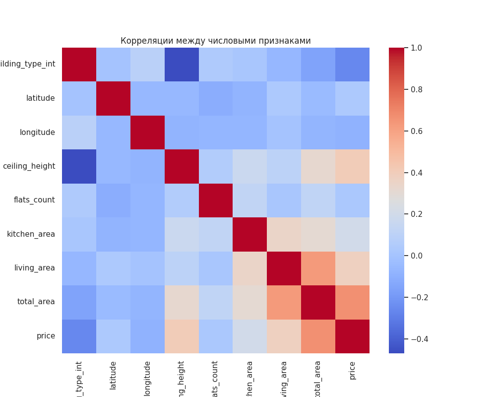
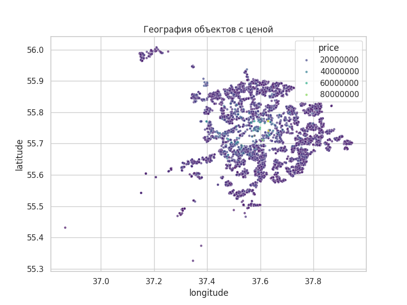
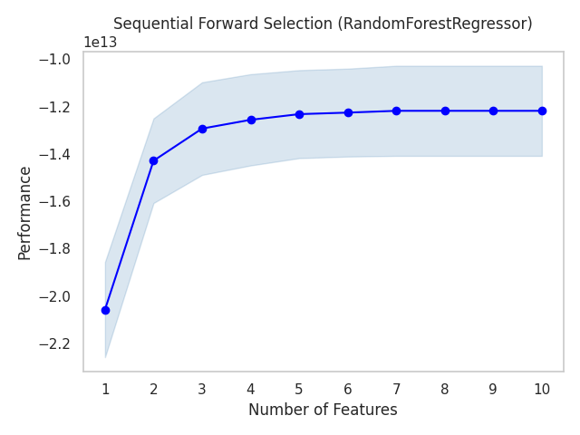
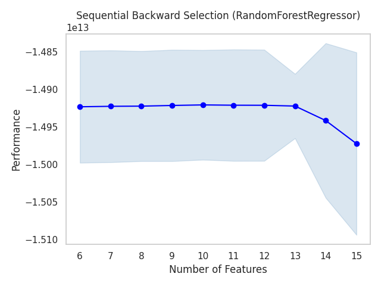

# Улучшение модели оценки стоимости квартир: эксперименты в MLflow


Учебный проект курса повышения квалификации «Инженер машинного обучения» (Яндекс Практикум, спринт 2).

**Итог:** за четыре версии модели, зарегистрированные в MLflow, RMSE на тесте снижен на 22,8 % (с 4,01 до 3,09 млн руб.), MAE на 20,1 %, R² вырос с 0,615 до 0,771.

**Использованные подходы:** feature engineering (ручной и автоматический), отбор признаков (SFS, SBS), подбор гиперпараметров (RandomizedSearchCV, Optuna), трекинг экспериментов и Model Registry в MLflow, воспроизводимая работа с ресурсными ограничениями.

Данные находились в PostgreSQL на учебном сервере курса и в репозиторий не входят. Код и ноутбуки с сохранёнными результатами показывают весь ход экспериментов.

## Задача

Яндекс Недвижимость оценивает рыночную стоимость квартир по их характеристикам. Цель проекта: улучшить базовую модель регрессии (CatBoost из проекта спринта 1) и оформить эксперименты воспроизводимо: с трекингом и версионированием моделей в MLflow.

## Результаты

Метрики на отложенной тестовой выборке (20 % данных). Цена в рублях, медиана цены в выборке ≈ 10,9 млн.

| Версия модели | Что изменено | RMSE | MAE | R² |
|---|---|---:|---:|---:|
| v1 (baseline) | модель из спринта 1 | 4 009 894 | 2 612 592 | 0,615 |
| v2 | ручные, полиномиальные признаки, бины, autofeat | 3 316 385 | 2 182 759 | 0,737 |
| v3 | отбор признаков (SFS + SBS, объединение) | 3 142 009 | 2 123 621 | 0,764 |
| **v4** | подбор гиперпараметров (Optuna) | **3 094 293** | **2 088 383** | **0,771** |

По сравнению с baseline RMSE снижен на 22,8 %, MAE на 20,1 %, R² вырос с 0,615 до 0,771.

## Что сделано

1. **MLflow.** Развёрнуты Tracking Server (PostgreSQL + S3) и Model Registry. Baseline залогирован и зарегистрирован как v1 (`train_old_registry.ipynb`).
2. **EDA.** Распределения признаков и цены, корреляции, зависимость цены от признаков и координат. Графики сохранены в `model_improvement/assets/` и залогированы в MLflow.
3. **Генерация признаков.** Расстояние до центра, доля жилой площади и другие ручные признаки; полиномиальные признаки и сплайны, бины; автоматическая генерация через `autofeat`. Всё собрано в единый sklearn `Pipeline` с `ColumnTransformer`. Модель v2.
4. **Отбор признаков.** Два метода из `mlxtend`: Forward Selection (10 признаков) и Backward Selection (6 признаков), пересечение 3. Для финальной модели взято объединение (13 признаков). Модель v3.
5. **Подбор гиперпараметров.** `RandomizedSearchCV` и Optuna (TPE) с логированием trial-ов в MLflow. Лучший RMSE по кросс-валидации у Optuna ≈ 3 068 804. Модель v4.

Для долгих вычислений (SFS/SBS) использована предварительная фильтрация признаков и подвыборка строк, чтобы укладываться в ресурсы виртуальной машины.

## Графики

| Корреляции числовых признаков | Цена по координатам |
|---|---|
|  |  |

| Forward Selection (SFS) | Backward Selection (SBS) |
|---|---|
|  |  |

Интерактивные графики Optuna лежат в `model_improvement/FS_ASSETS/` (`optuna_optimization_history.html`, `optuna_contour.html`, `optuna_param_importances.html` и другие).

## Структура

```text
.
├── run_mlflow_server_full.sh        # запуск MLflow Tracking Server и Model Registry
├── .env.example                     # шаблон переменных окружения
├── requirements.txt
├── train_old_registry.ipynb         # baseline и регистрация модели v1
├── model_improvement/
│   ├── model_improvement.ipynb   # EDA, признаки, отбор, подбор параметров, модели v2–v4
│   ├── assets/                      # графики EDA
│   └── FS_ASSETS/                   # графики отбора признаков и Optuna, список признаков
└── services/models/                 # сохранённая baseline-модель CatBoost
```

## Установка и запуск

См. [INSTALL.md](INSTALL.md).
